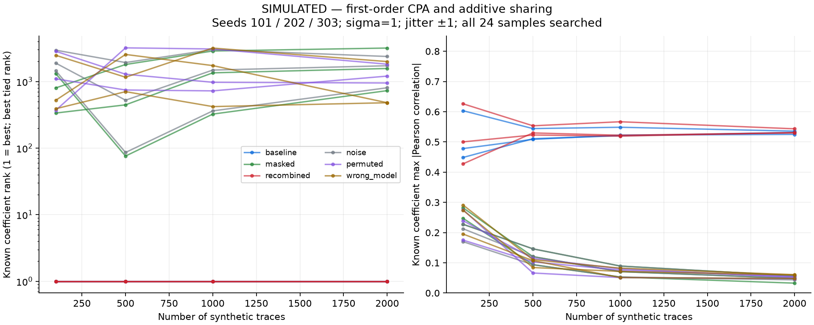

# ML-KEM side-channel learning lab

**A reproducible host-only experiment: leakage → correlation attack → educational sharing → evaluation.**  
**Evidence status:** ML-KEM-512 correctness tests **PASS**; side-channel leakage and attacks **SIMULATED**; **no physical traces, no full ML-KEM attack, and no validated masking security**.

This project investigates how a *secret-dependent arithmetic sub-operation relevant to ML-KEM decapsulation* can leak information in a deliberately simplified laboratory model. It separately validates a pinned FIPS-203-aligned ML-KEM-512 software baseline against NIST ACVP vectors. The small arithmetic target is **not** a full ML-KEM implementation.

Read [executed results](docs/RESULTS.md), [Project progress](docs/PROGRESS.md), [research design](docs/RESEARCH_DESIGN.md), and [limitations](docs/LIMITATIONS.md).

## Research question and experiment

For a controlled public coefficient `a`, a single laboratory secret coefficient `s`, and `q = 3329`, consider

```text
y = (a * s) mod 3329
```

The simulator generates 24-sample **synthetic** traces with a Hamming-weight output signal, Gaussian noise, and discrete timing jitter. First-order Pearson CPA searches **all 3329 coefficient candidates** and all samples, then checks the rank of the known fixture. It uses a predeclared set of three seeds and 100/500/1000/2000-trace prefixes, plus noise-only, permuted-input, and wrong-model controls.

An educational additive-sharing variant chooses a fresh random simulation share `r` and computes:

```text
s0 = r
s1 = (s - r) mod 3329
y0 = (a*s0) mod 3329
y1 = (a*s1) mod 3329
(y0 + y1) mod 3329 == (a*s) mod 3329
```

Two separated share-output leakage pulses are compared against the unprotected baseline. A deliberately vulnerable variant also leaks the recombined output, illustrating why a hidden recombination window cannot be assumed. This is **not a complete masked ML-KEM**, and higher-order/transition leakage is outside the simple model.

## Results at a glance

| Evidence | Result | Interpretation |
|---|---|---|
| Host ML-KEM-512 | 25 keygen + 25 encapsulation + 10 decapsulation NIST KAT cases; 100 randomized round trips | Correctness evidence within the supported low-level API, **not FIPS certification** |
| Scalar C arithmetic | 11,082,241 input pairs checked | Functional arithmetic tests passed |
| Additive-sharing C correctness | 11,082,241 share pairs + 119,844 boundary triples | Mathematical recombination checks passed |
| Unprotected **simulated** CPA | Rank 1 in seeds 101 / 202 / 303 at 2000 traces | The model permits recovery of one laboratory coefficient |
| Share-only **simulated** CPA | True rank 729 / 3178 / 1567 | No fixture recovery by this first-order attack in these runs |
| Recombined-output **simulated** CPA | Rank 1 in all three seeds | Showing recombination leakage removes the apparent advantage |
| Limited Ryzen/MinGW host benchmark | Median 1.874 vs 4.349 ns/call (2.32×) | Excludes RNG, share setup and recombination; not MCU timing |
| Physical Nano capture | **NOT RUN** | No physical side-channel result |
| STM32F407 full-scheme firmware | **BLOCKED** | No verified board-specific build, cycle count, or external signal path |



All experiments are labeled in [RESULTS.md](docs/RESULTS.md). Actual scripts and machine-readable summaries are in `scripts/` and `results/`.

## Why the toy model is related to ML-KEM — and what it omits

The pinned PQClean decapsulation path runs `indcpa_dec`, uses ciphertext-derived polynomial data and secret polynomials in `polyvec_basemul_acc_montgomery`, then performs inverse-NTT and subsequent steps. The toy `a*s mod 3329` is a **surrogate for an individual secret-dependent multiplication**, not a substitution for the actual NTT-domain `basemul` / Montgomery representation, ciphertext constraints, or firmware. Mathematical equivalence does **not** imply equivalent physical leakage. The repository does not reproduce the plaintext-checking-oracle EM attack in *Find the Bad Apples* (TCHES 2023), or the complete masked Kyber constructions in *Masking Kyber* (TCHES 2021).

## Evidence stages

| Stage | Status | Scope |
|---|---|---|
| D0: Research setup | PASS | Pinned dependencies, protocol and literature audit |
| D1: Full ML-KEM software baseline | PASS (host scope) | NIST vectors, round trips and implicit-rejection checks |
| D2: Isolated arithmetic + CPA | SIMULATED | Exhaustive scalar tests and simulated traces |
| D3: Sharing + evaluation | SIMULATED | Functionally tested shares, controlled comparisons and limited host cost |
| D4: Nano-onboard physical experiment | NOT RUN | No working target firmware/capture pipeline yet |
| D5: STM32F407 full-scheme/external capture | BLOCKED | Verified linker/toolchain and safe analog interface outstanding |

## Reproduce the host experiment

Requires Python (the original run used 3.13 on Windows; sanitizer tests were also performed under Ubuntu Python 3.10), GCC or compatible compiler, and the pinned Python packages. From the repository root:

```bash
python -m venv .venv
# Windows PowerShell: .venv\Scripts\Activate.ps1
# Linux/macOS: source .venv/bin/activate
python -m pip install -r requirements.txt
python tasks.py help
python tasks.py all
```

This runs environment probing, C/Python tests, host ML-KEM checks, sanitizer checks where supported, simulation, multi-seed CPA evaluation, benchmark, and report generation. Windows MinGW may lack ASan/UBSan runtimes; the committed Ubuntu/WSL results and GitHub Actions job provide additional sanitizer evidence. A successful GitHub Actions run executed `test`, `host-mlkem`, `sanitize`, and `attack-sim`; the workflow does **not** include the host benchmark or Markdown/figure report-generation stages.

Other useful commands:

```bash
python scripts/capture_nano.py --inspect-only
python tasks.py stm32-build
python -m pytest tests/test_cpa.py -q
```

The first command only reports **deferred capture** status; it does not detect or collect from a real Nano. The ARM build command fails explicitly until board-specific integration is available. Neither is a working hardware path today.

## Repository map

- `src/`: scalar baseline and educational additive-share routines.
- `scripts/simulate_leakage.py`, `attack_cpa.py`, `evaluate_countermeasure.py`: synthetic leakage generation, CPA, and comparisons.
- `tests/`: exhaustive arithmetic, Python control tests, reference multiplication relation and ML-KEM adapter.
- `third_party/`, `upstream-lock.json`: pinned, attributed upstream ML-KEM source and NIST test vectors; hashes verified before use.
- `results/`: committed summaries and clearly labeled simulation figures.
- `docs/`: experimental protocol, results, literature review, threat model, limitations, environment and hardware checklist.
- `firmware/`: deferred-stage notes, **not** deployable firmware.
- `local-results/`, `build/`: ignored raw datasets and local build outputs.

## Research limitations and next steps

**Simulation is not evidence of a physical side-channel vulnerability or protection.** The share split uses caller-provided randomness in C; real entropy, register/memory leakage, transition leakage, trigger placement, recombination, higher-order attacks, and ARM-compiled behavior must be studied before making security claims. Passing host tests is not a certification or proof of absence of implementation weaknesses.

When the ChipWhisperer Nano is actually available, first identify its revision and complete a stock onboard sanity capture. Next, port **only the isolated kernel** to the integrated small target, inspect real ARM assembly, and obtain controlled physical traces. Full-scheme STM32F407 correctness/benchmarking is a separate engineering task; Nano-to-external-target power measurement is **not** assumed feasible without verifying the specific boards and safe analog interface.

Selected references: [NIST FIPS 203](https://csrc.nist.gov/pubs/fips/203/final), [*Find the Bad Apples* (TCHES 2023)](https://doi.org/10.46586/tches.v2023.i1.89-112), [*Masking Kyber* (TCHES 2021)](https://doi.org/10.46586/tches.v2021.i4.173-214). See [REFERENCES.md](docs/REFERENCES.md) for provenance and the broader peer-reviewed paper matrix.

**Research-learning prototype only. Not production cryptographic code.**
