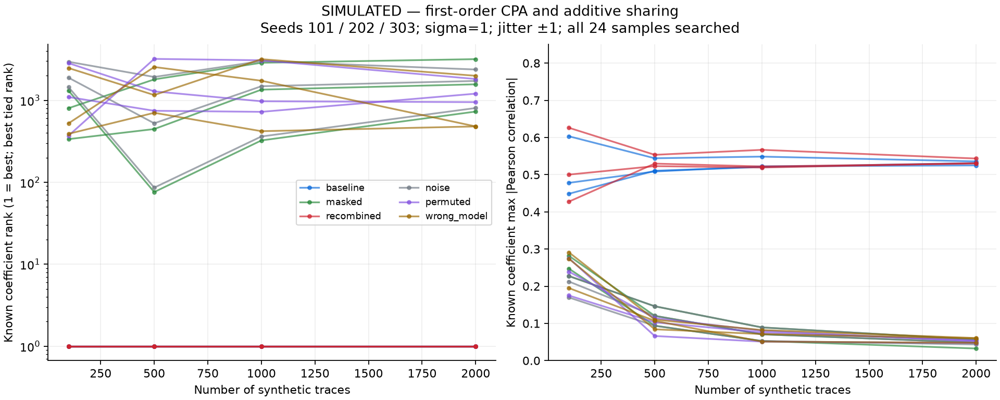

# Project progress

## Aim

Build a reproducible leakage → attack → countermeasure → evaluation lab, using the available Nano AES baseline and sibling STM32F407 firmware evidence while keeping full ML-KEM correctness separate from scalar leakage demonstrations.

## What is implemented

- [Pinned ML-KEM host adapter](../tests/mlkem_driver.c) and [NIST vector runner](../scripts/host_mlkem.py); unmodified upstream sources and hashes.
- [Scalar multiplication](../src/baseline.c), [share setup](../src/kernel.c), [shared multiplication](../src/masked.c), exhaustive C and independent Python checks.
- [Simulator](../scripts/simulate_leakage.py), [chunked CPA](../scripts/attack_cpa.py), [multi-seed controls](../scripts/evaluate_countermeasure.py), and host benchmark/assembly reports.
- [Research design](RESEARCH_DESIGN.md), [literature audit](LITERATURE_REVIEW.md), environment probe, runnable tasks and a successfully executed [host CI workflow](../.github/workflows/host.yml).

## What was actually executed

`python tasks.py doctor`, `test`, `host-mlkem`, `sanitize`, `simulate`, `attack-sim`, `bench`, and `report`. Hardware guards were also checked; no device opened or flashed.

PASS: 11,082,241 scalar pairs against repeated addition; 11,082,241 share pairs with varying multipliers and 119,844 boundary triples; six Python tests. ML-KEM: 60 official NIST KAT cases, 25 deterministic round trips/rejection checks, 100 randomized round trips/altered ciphertexts, nine adapter length rejections.

## Preliminary results

At 2000 traces, baseline rank is 1 for all three seeds (|r| 0.525–0.536); shared-output ranks are 729, 3178, 1567 (|r| 0.0325–0.0565). Visible recombination restores rank 1 in every seed. Noise-only, label-permutation and wrong-product-HW controls do not uniquely recover the fixture.

Host-only median: 1.874 ns/call baseline, 4.349 ns/call shared variant, ratio 2.32×. This excludes RNG/setup/recombination and includes loop/call/checksum work. See [all measurements](RESULTS.md) and [assembly/stack scope](ASSEMBLY_AUDIT.md).

## Scientific limitations

All leakage is SIMULATED. This is one coefficient under a stated HW model, not a full-key ML-KEM attack or secure masking construction. Real Montgomery encoding, transition/higher-order leakage, setup and recombination can change the outcome. NIST key-validation cases are outside the selected low-level API; no FIPS certification. The USENIX paper uses STM32F3 for Kyber and STM32F4 for ASCON.

Latest local sanitizer results: address: PASS (gcc (Ubuntu 11.4.0-1ubuntu1~22.04.3) 11.4.0); undefined: PASS (gcc (Ubuntu 11.4.0-1ubuntu1~22.04.3) 11.4.0). Passing runs cover the exhaustive kernel and full ML-KEM adapter/KAT tests. Platform diagnostics are preserved. The initial sandbox denied WSL and USB enumeration; an authorized follow-up reached Ubuntu. That preflight did not find an ARM compiler on PATH; the sibling `ml-kem-m4` repository later used ARM GCC 14.3.1 for a Cortex-M4 build and functional board validation. The Nano ML-KEM firmware/capture pipeline in this repository is unimplemented and NOT RUN. External power capture still requires a verified safe analog interface.

## Hosted CI evidence

[GitHub Actions run 40989404872](https://github.com/joeywwong/ml-kem-side-channel/actions/runs/40989404872) succeeded at commit `3f3d164093f16393059dd82ac604d2dd23d01db5`. Its only job, `host`, used Ubuntu 24.04, Python 3.13.17 and GCC 13.3.0. After installing requirements it ran `test`, `host-mlkem`, `sanitize`, an assertion that both ASan and UBSan passed, and `attack-sim`; all succeeded. It did not run `doctor`, standalone `simulate`, `bench`, `report`, or hardware tasks. Metrics in this report come from saved local JSON; the hosted job did not generate this report.

## Next steps for Nano ML-KEM capture

Identify the Nano PCB/firmware revision and use the completed stock AES capture as a baseline before porting the small kernel. Keep the built-in target intact. The sibling F407 build and board tests are complete within their documented scope; external power measurement needs a verified safe analog interface.

**Highest-value next step:** identify the Nano revision and implement a bounded scalar experiment, then validate it against the existing stock AES capture baseline.
