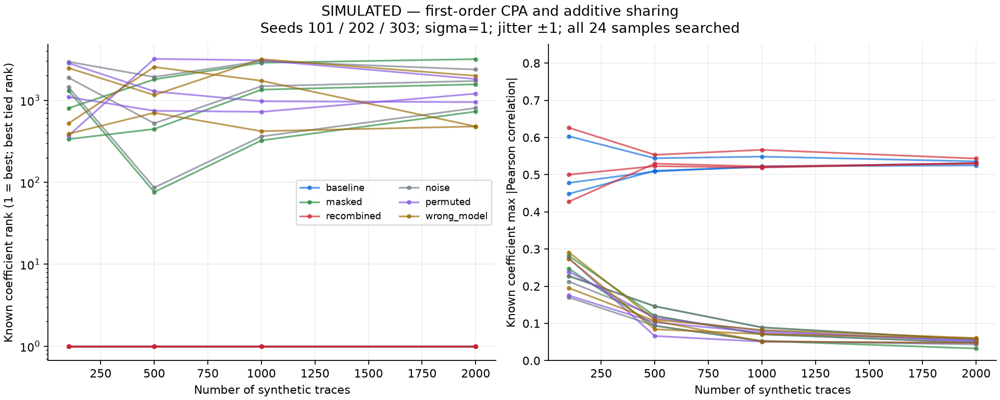
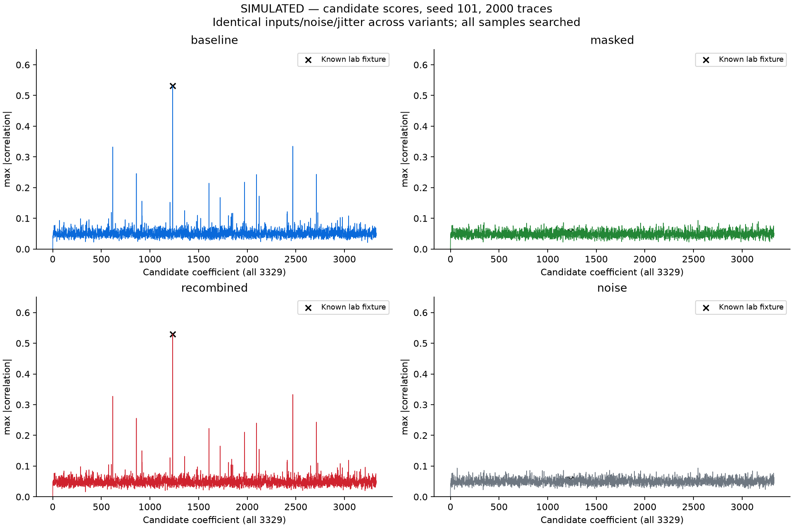
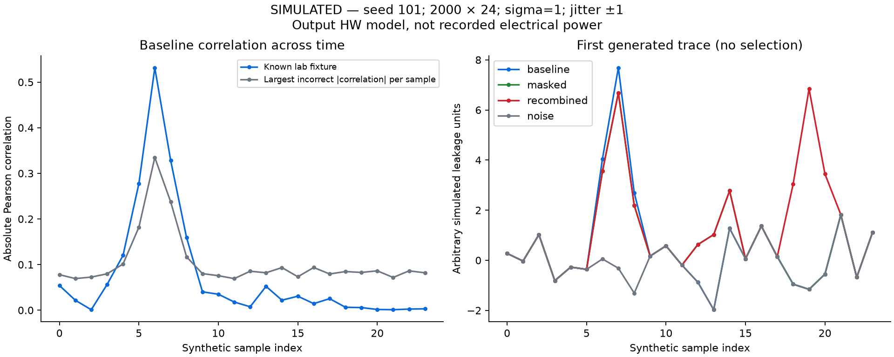

# Executed results

Generated by `python tasks.py report` from saved JSON, not hand-entered metrics.

| Stage | Status | Evidence |
|---|---|---|
| D0 | PASS | Environment, pinned sources, literature/protocol, task runner |
| D1 | PASS (host scope) | 25 keygen + 25 encapsulation + 10 decapsulation NIST KATs; 100 random round trips |
| D2 | SIMULATED | Exhaustive scalar tests; positive and negative CPA controls |
| D3 | SIMULATED | Sharing equivalence, multi-seed evaluation, recombination failure; host timing measured |
| D4 | NOT RUN (NO HARDWARE) | Nano firmware/serial/capture pipeline unimplemented |
| D5 | BLOCKED / unfinished | No board-specific firmware build or external capture pipeline; toolchain/board integration and safe analog interface outstanding |

## Correctness and toolchain

PASS: 11082241 scalar pairs; 11082241 share pairs; 119844 boundary triples

......                                                                   [100%]
6 passed in 4.42s

NIST byte-for-byte vectors are independent of the implementation. Also checked 25 deterministic round trips and altered ciphertext rejection against Python SHAKE-256, plus 9 adapter length rejections. The upstream low-level API does not expose the 20 key-validation cases; those are not claimed tested. No FIPS certification.

Sanitizers (latest run): address: PASS (gcc (Ubuntu 11.4.0-1ubuntu1~22.04.3) 11.4.0); undefined: PASS (gcc (Ubuntu 11.4.0-1ubuntu1~22.04.3) 11.4.0). See [diagnostics and host](../results/sanitizers.json). Platform-specific snapshots retain other executed environments.

## CPA at 2000 synthetic traces

| Seed | Variant | True rank (best–worst tie) | True max abs correlation | Largest candidate correlation | Verified recovery |
|---:|---|---:|---:|---:|---|
| 101 | baseline | 1–1 | 0.5314 | 0.5314 | True |
| 101 | masked | 729–729 | 0.0565 | 0.0936 | False |
| 101 | recombined | 1–1 | 0.5300 | 0.5300 | True |
| 101 | noise | 805–805 | 0.0565 | 0.0936 | False |
| 101 | permuted | 1819–1819 | 0.0472 | 0.1002 | False |
| 101 | wrong_model | 480–482 | 0.0606 | 0.0907 | False |
| 202 | baseline | 1–1 | 0.5357 | 0.5357 | True |
| 202 | masked | 3178–3178 | 0.0325 | 0.0918 | False |
| 202 | recombined | 1–1 | 0.5434 | 0.5434 | True |
| 202 | noise | 2375–2375 | 0.0435 | 0.0918 | False |
| 202 | permuted | 950–950 | 0.0538 | 0.1024 | False |
| 202 | wrong_model | 480–482 | 0.0598 | 0.0917 | False |
| 303 | baseline | 1–1 | 0.5250 | 0.5250 | True |
| 303 | masked | 1567–1567 | 0.0484 | 0.0942 | False |
| 303 | recombined | 1–1 | 0.5309 | 0.5309 | True |
| 303 | noise | 1723–1723 | 0.0484 | 0.0979 | False |
| 303 | permuted | 1205–1205 | 0.0518 | 0.0926 | False |
| 303 | wrong_model | 1991–1993 | 0.0479 | 0.1288 | False |

All runs and prefixes are retained in [simulation.json](../results/simulation.json). Ranks are 1-based; wrong-product-HW hypotheses can be equivalent, so tied intervals are reported. Searching 3329 guesses × 24 samples inflates null maxima. No significance or security conclusion is inferred from a small correlation.

Baseline and deliberately visible recombination recover in these runs. The favorable share-only model does not recover. This is a model demonstration; no physical masking security is established.







## Host cost (not MCU cycles)

Host: AMD Ryzen 7 7735U with Radeon Graphics; Windows-11-10.0.26300-SP0. Compiler: gcc (MinGW-W64 x86_64-ucrt-posix-seh, built by Brecht Sanders, r8) 13.2.0. Flags: `-std=c99 -O2 -Wall -Wextra -Werror -fno-lto`.

| Variant | Timed batches | Min ns/call | Median ns/call | Max ns/call | Stdev ns/call |
|---|---:|---:|---:|---:|---:|
| baseline | 9 | 1.797 | 1.874 | 2.672 | 0.285 |
| masked | 9 | 4.174 | 4.349 | 5.882 | 0.532 |

Median batch ratio: 2.32× for this host run. 10 million calls/batch, alternating order, one warmup batch per variant excluded. Inputs/shares precomputed; entropy, split and recombination excluded. Call/loop/checksum costs included. This is not full countermeasure overhead or a prediction for F030/F407.

Compiler object/stack reports and all batches: [benchmark.json](../results/benchmark.json). Assembly interpretation: [ASSEMBLY_AUDIT.md](ASSEMBLY_AUDIT.md).

## Reproduce

```powershell
python tasks.py all
```

Or run `doctor`, `test`, `host-mlkem`, `sanitize`, `simulate`, `attack-sim`, `bench`, then `report` separately. `make` forwards to the same runner where available. Exact source/vector hashes are in [upstream-lock.json](../upstream-lock.json); original-code hashes in [run-manifest.json](../results/run-manifest.json).

## Hosted CI evidence

[GitHub Actions run 40989404872](https://github.com/joeywwong/ml-kem-side-channel/actions/runs/40989404872) succeeded at commit `3f3d164093f16393059dd82ac604d2dd23d01db5`. Its only job, `host`, used Ubuntu 24.04, Python 3.13.17 and GCC 13.3.0. After installing requirements it ran `test`, `host-mlkem`, `sanitize`, an assertion that both ASan and UBSan passed, and `attack-sim`; all succeeded. It did not run `doctor`, standalone `simulate`, `bench`, `report`, or hardware tasks. Metrics in this report come from saved local JSON; the hosted job did not generate this report.

No hardware capture, MCU execution, or firmware implementation is demonstrated. D4 firmware/capture and D5 board-specific firmware/external capture remain unfinished.
